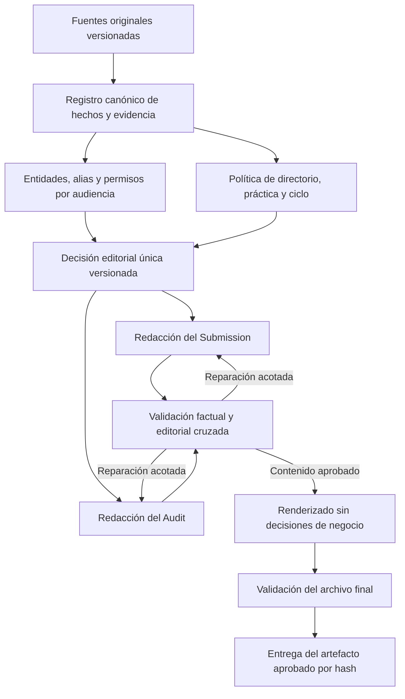

# Dictamen técnico de RankPilot y ruta de implementación

Fecha: 2 de octubre de 2026. Baseline local: `af1368558ed38309e630b647e08dac9423848e02`.

> Actualización: la validación posterior con datos de Ángela, logs Vercel, backend desplegado y modelos reales, junto con la decisión arquitectónica y el plan de PRs, está en [PLAN_MAESTRO_RANKPILOT_2026-10-02.md](PLAN_MAESTRO_RANKPILOT_2026-10-02.md). Los límites de acceso descritos aquí corresponden a la primera revisión.

## Decisión recomendada

**Reformular el flujo, conservando los componentes útiles. Aprobar la separación de responsabilidades propuesta por Gemini, pero no aprobar su implementación literal ni sus garantías de calidad, costo o plazo.**

El problema demostrado no es simplemente tener veinte nodos. Es que distintas capas reinterpretan los hechos, seleccionan asuntos, asignan bandas y reescriben los documentos, sin una decisión canónica vinculante ni una aprobación asociada al archivo exacto que recibe el usuario. Varias correcciones convierten ejemplos de Ángela en reglas globales o texto fijo. Esto produce sobreajuste a los casos conocidos y nuevas regresiones.

La primera implementación debe corregir la integridad de la entrega y establecer evidencia de aceptación de extremo a extremo. Reducir nodos viene después, con mediciones comparativas. Un renderer determinista también puede inventar hechos de manera perfectamente repetible; hoy sucede.

## 1. Alcance y límites de esta revisión

Se revisaron la propuesta completa, los 30 commits recientes y el historial específico del validador; los changelogs general y Python; el grafo, contratos, RAG, jueces, rutas de optimización, Studio, curadores y builders; pruebas existentes; resultados JSON históricos; y una muestra dirigida de fuentes, conversaciones de referencia y entregables de Ángela. Se inspeccionó también una captura de Energy que reproduce un fallo de descarga por `ByteString`.

El repositorio activo está en `rankpilot-new-repo`. La propuesta de Gemini estaba sin seguimiento en Git; no había cambios rastreados pendientes. `rankpilot-core` y `rAnkpIlot-main` son directorios adicionales: este dictamen no los trata como la aplicación desplegada.

Verificación ejecutada:

- `cd ai-engine && python3 -m unittest discover -s tests -v`: **98 pruebas, todas pasan**.
- Generación local de dos Audit DOCX sintéticos con el builder actual, inspeccionando `word/document.xml`.
- Reproducción directa del anonimizador, sin LLM.
- Inspección del texto OOXML de los entregables Ramos `29-angela-1` y DeForest `28-jonathan-5`, y conversaciones de referencia.

No se ejecutó una corrida nueva con modelos remotos, no se consultaron logs de producción ni base de datos, y no se comprobó qué SHA está desplegado. Los archivos históricos no permiten atribuir todos sus errores al HEAD actual. No se certifica paginación real de Word/Google Docs por contar palabras o leer metadatos. Los resultados locales siguientes sí corresponden al código del baseline.

## 2. Hallazgos demostrados y prioridad

### P0 — El Audit nuevo genera hechos de otra firma y certificaciones falsas

En [`audit-builder.ts`](../src/app/api/generate-docx/audit-builder.ts), líneas 111–198:

- La banda depende del nombre de la práctica: Labour → Band 5; Real Estate → Band 4 / Up and Coming; Tax → Band 1 / Band 2.
- `Math.max(90, Math.min(96, analysis.score || 94))` fuerza el score al intervalo 90–96. Un 12 termina como 90; un 0 se sustituye por 94.
- Cualquier práctica laboral recibe el equipo de 27 abogados, cinco oficinas, cobertura de más de veinte jurisdicciones y los nombres de DeForest.
- La narrativa afirma «exactly 20 official matters» aunque el conteo real sea otro.
- Un asunto sin lead partner recibe `Eduardo Garduño` como valor de respaldo.

**Prueba:** una firma sintética ajena, un asunto, sin abogados y score 12 produjo todos esos errores. Otra entrada de Energy marcada como insuficiente recibió un veredicto positivo de Band 4 y score 90. El nuevo builder no consume la insuficiencia como decisión vinculante. Este cambio contradice el blindaje anunciado por v29.6.

### P0 — La aprobación de entrega puede ser eludida

[`generate-docx/route.ts:103`](../src/app/api/generate-docx/route.ts) permite exportar cuando `(veredicto aprobado y builder disponible) || hasMatters`. Tener asuntos hace pasar esa comprobación aunque el veredicto sea negativo. El Audit ni siquiera requiere ese control.

Sí existen validaciones adicionales en el builder del Submission; esto no demuestra que cualquier documento defectuoso pueda salir. Demuestra que **el veredicto central no gobierna la entrega** y que no hay un único contrato de liberación compartido.

Además, se puede devolver un DOCX clonado o regenerar otro desde datos actuales. La aprobación debe estar ligada a la versión del dossier, estrategia y hash del artefacto correspondiente; no basta un booleano histórico.

### P0 — La confidencialidad mezcla diccionario global y coincidencias textuales

[`lawyer-curator.ts:82`](../src/lib/docx/lawyer-curator.ts) sustituye nombres conocidos aunque no exista ninguna entidad confidencial en la entrada. La prueba:

```text
Entrada: Our office is in Hermosillo. We advised Volkswagen.
Entidades confidenciales: []
Salida: Our office is in a major private agricultural enterprise.
        We advised a leading global automotive manufacturer.
```

Esto altera hechos y demuestra que el diccionario confunde lugares, entidades y permisos. En sentido contrario, el control de integridad descarta nombres de menos de cuatro caracteres (`artifact-integrity-check.ts:598–613`), dejando un hueco para siglas nuevas. El diccionario conoce algunas siglas históricas, pero eso no resuelve el caso general.

El control final del Submission también reconstruye texto para comprobarlo: no inspecciona todo el OOXML final y su reconstrucción de B9 no incluye todos los campos renderizados. Se necesita validar la representación exacta entregada, incluyendo secciones públicas, encabezados, pies, hipervínculos y metadatos relevantes.

### P1 — Hay dos jueces con autoridades y coberturas diferentes

El juez Python usa un LLM independiente, pero [`constitutional_validator.py:673`](../ai-engine/agents/constitutional_validator.py) aprueba cuando pasa Layer 1 aunque falle Layer 2. No es una inferencia: existe una prueba llamada `test_judge_sol_evaluates_with_score_and_feedback_without_blocking_delivery` que protege ese comportamiento.

El llamado Judge Sol de TypeScript es una función determinista, no otra ejecución del modelo Sol. Su check de confidencialidad comprueba la clasificación de los asuntos públicos, no todas las menciones en B9/B10/C2. Su `passed` exige cero violaciones, pero `status` se calcula por umbrales y puede ser `passed` con `passed: false` (`judge-sol-evaluator.ts:607–620`).

La solución no es añadir un tercer juez. Hay que definir una sola política: errores materiales bloquean la entrega final; observaciones estilísticas no destruyen un borrador útil; el juez semántico puede declarar evidencia insuficiente y no debe inventar una reparación factual.

### P1 — Se toma estrategia durante la generación del documento

Los builders llaman otra vez a `curateMatters` y `curateLawyers`. El curador de asuntos asigna primas explícitas por nombres conocidos; el de abogados fija perfiles y bandas por nombres y apellidos. El vínculo abogado–asunto admite cualquier token de nombre coincidente en texto, mezclando liderazgo, apoyo y mera mención (`lawyer-curator.ts:367–375`).

Esto permite decisiones distintas entre Studio, Audit y Submission, y asociación incorrecta de personas con apellidos compartidos. También permite que un cambio de datos después de la revisión cambie silenciosamente la cartera exportada.

### P1 — Las pruebas actuales no equivalen a aceptación del producto

Hay pruebas útiles de reconciliación, evidencia, OOXML y reintentos. Deben conservarse. Sin embargo, las 98 pasan al mismo tiempo que el builder reproduce los seis defectos de este dictamen.

Algunos «golden evals» comprueban que un literal escrito dentro del propio test contiene una cifra esperada; por ejemplo Bemis, Duranpark y El Cielo en `test_golden_evals.py`. No ejecutan el generador para esos casos. El informe `OWNER_FEEDBACK_ACCEPTANCE_31_08.md` reconoce expresamente que faltaba aceptación con entregables nuevos.

## 3. Qué enseña el historial y el material de Ángela

| Evidencia | Lectura técnica |
|---|---|
| `d73ae0e`, 2 septiembre: reintentos dirigidos; `48b5565` y `abbfcc3`, 3 septiembre: aprobación por Layer 1 y juez consultivo | Ya existían ciclos; posteriormente se relajó el poder de bloqueo. No es ausencia total de arquitectura de control. |
| Serie v26.35–v26.40: bandas, carteras, hero y trazabilidad por nombres | Se acumulan reglas de casos concretos en varias capas. |
| `fb51f86`, 28 septiembre: auto-polisher y certificación 10/10 | La certificación local antecede a nuevas correcciones. Su score no prueba aceptación por Ángela. |
| `200b4a2`, `16284f3`, `ca8ea9c`, 30 septiembre: Real Estate, Labour y Energy | Se siguen corrigiendo las mismas familias: voz, hechos, confidencialidad y consistencia. |
| `c889c91`, 1 octubre: matriz de quince puntos | Más checks, pero sin una cobertura uniforme del archivo final. |
| `af13685`, 2 octubre: Audit de cinco secciones | Reduce ruido estructural, pero introduce hechos universales de los benchmarks y scores forzados. No es blindaje completo. |

En el Audit Ramos `29-angela-1` aparecen a la vez indicadores 94/96/100, «Insufficient Evidence for Full Analysis», métricas 0% y una cartera de 16 asuntos con reservas justificadas por un techo de veinte. Su Submission pide ascender de Band 2 a Band 1 y usa «verified evidentiary record». El par DeForest `28-jonathan-5` reproduce varias de esas contradicciones. Estos documentos corroboran el tipo de problema reportado; no prueban que cada frase siga presente tras los fixes posteriores.

Las conversaciones de referencia aportan un criterio más fino que una fórmula de montos. En DeForest, Eduardo → Javier → Jaime se justifica con liderazgo acumulativo, especialización, recurrencia y señales de mercado; Jaime tiene más asuntos en una comparación inicial, pero Javier se prioriza por evidencia cualitativa. El documento distingue valor de infraestructura, importe litigioso y rol concreto. USD 2.5 mil millones de proyecto no es automáticamente cuantía de litigio ni contribución atribuible al abogado.

En la referencia de Ramos hay una corrección explícita por haber revisado inicialmente un universo incompleto. La selección cambia después de examinar más asuntos. Esas conversaciones mezclan intervenciones de la dueña y respuestas de IA; no debe convertirse cada frase en una regla aprobada. Hay que registrar autor, versión, fuente y decisión final, y retirar reglas sustituidas. Los criterios sobre COMINVI y cantidades seleccionadas evolucionan: requieren contexto, no un bonus permanente por nombre.

## 4. Dictamen sobre la propuesta de Gemini

| Propuesta | Decisión |
|---|---|
| Hechos tipados, evidencia trazable y separación de voces | Aceptar y extender lo existente. `core/contracts.py` ya contiene `SourceSpan`, `EvidenceClaim`, `MatterRecord` y `CanonicalSubmission`. Pydantic valida forma, no veracidad. |
| Cuatro roles especializados | Aceptar como organización conceptual, no como límite de cuatro llamadas. |
| LangGraph transmite inevitablemente todo el estado al modelo | Rechazar. Los prompts controlan el payload; los nodos actuales ya construyen `input_data` parciales. Hay repetición y acoplamiento, pero falta un perfil de tokens por llamada para cuantificarlos. |
| No hay juez ni bucle | Rechazar como descripción del baseline. Existen ambos; están fragmentados y parte del veto fue desactivado. |
| Un mapa de entidades garantiza cero fugas | Rechazar la garantía. Aceptar registro por dossier, alias, permisos y proyecciones según audiencia, más validación posterior. |
| Bandas calculadas por lead matters × monto × complejidad | Rechazar. Puede orientar priorización interna, no determinar una banda ni comparar monedas o tipos de valor sin contexto. |
| Siempre veinte asuntos y veinte referees | Sustituir por política de guía/práctica/ciclo y selección por evidencia. No rellenar una cartera débil para completar un número. |
| Audit de cinco secciones | Aceptar. Presupuesto editorial para 4–5 páginas, anexo separado y comprobación real de renderizado. |
| Éxito >98%, ahorro 65%, latencia de un minuto | Hipótesis sin benchmark reproducible. Un juez que se otorga 96 no demuestra 98% de éxito en primer intento. |
| Fase 1 completada al 100%; migración en nueve días | Rechazar como compromiso verificable. Los fallos actuales contradicen la primera afirmación y no existe evidencia para garantizar el plazo. |

La propuesta usa GPT-4o/Claude 3.5 como base de cálculo; el código Python configura Terra por defecto y Sol para el juez, salvo overrides de entorno. Los resultados históricos disponibles registran 620 s y 867.9 s en comparaciones anteriores, no los 180–260 s asumidos. Esos tiempos tampoco son un benchmark del HEAD. Sin tokens de entrada/salida/caché, configuración real y ruta ejecutada, no hay estimación de ahorro defendible.

## 5. Arquitectura que implementaría



La pieza que falta en el diseño de Gemini es `EditorialDecision`: misma selección de asuntos, orden, hero, reservas, exclusiones y candidaturas para ambos redactores. Su diagrama paraleliza A2 y A3, pero A3 necesita una selección preliminar que nadie produce como contrato común. Esa dependencia debe resolverse antes de paralelizar.

Contratos mínimos:

- `FactLedger`: IDs estables; fuente/tabla/celda/párrafo; hechos explícitos, desconocidos y conflictivos; moneda y `value_type`; roles lead/support; estados y fechas. Separar fuente del cliente de evidencia externa, con procedencia para ambas.
- `EntityRegistry`: entidad, alias y descriptores sustentados; permisos por asunto, campo y audiencia; versión. La inmutabilidad aplica a una versión aprobada, no impide corregir extracción.
- `DirectoryPolicy`: guía, jurisdicción, práctica, ciclo, unidad de ranking, categorías válidas, ventanas y límites verificados. Ausencia de dato no equivale a 0 ni a falso.
- `EditorialDecision`: IDs seleccionados, orden y hero; reservas/exclusiones mutuamente consistentes; candidato, evidencia y recomendación con incertidumbre; datos faltantes; overrides justificados y versionados.
- `SubmissionDraft` y `AuditDraft`: referencias a hechos y a la misma decisión; voces distintas. El Audit puede advertir un límite sin convertirlo en afirmación pública del Submission.
- `ValidationReport`: regla, severidad, campo, evidencia, reparación permitida y resultado. Score editorial separado de integridad factual y suficiencia estratégica.
- `ReleaseManifest`: hashes de entrada, decisión, contenido y archivo; versiones de reglas/modelos/prompts; resultado de validación y modo de entrega.

Distinguir `draft`, `needs_information`, `ready_for_review`, `approved` y `blocked`. Conservar borradores y feedback cuando falta evidencia; permitir su descarga con estado explícito cuando sea apropiado. Una fuga en contenido público o un hecho fabricado no se convierte en entrega final por superar un score. No borrar advertencias reales para evitar «panic text»; expresarlas con precisión en la audiencia adecuada.

Conservar parsers DOC/DOCX/PDF, reconciliación, contratos, validación OOXML, RAG por práctica, optimización por asunto y builders como infraestructura. Extraer de ellos las decisiones de negocio y las biografías prefabricadas. No eliminar módulos hasta que las rutas nuevas demuestren equivalencia o mejora en todos los casos críticos.

## 6. Respuestas a las cuatro preguntas de la sección 7

**1. Orquestación.** Mantendría LangGraph simplificado, con pasos explícitos y estado tipado. Ya hay integración, streaming y reintentos; cambiar simultáneamente motor y arquitectura añade riesgo. Un workflow predeterminado encaja mejor que agentes que elijan libremente qué hacer. La documentación de LangGraph contempla ambos y ofrece persistencia y streaming. Usaría checkpoints durables en producción; `MemorySaver` no proporciona durabilidad entre procesos. Registrar presupuesto de reintentos global y por fragmento, tiempo máximo e idempotencia. Al reparar un dato que afecte cartera o candidaturas, invalidar todos sus dependientes. [Workflows](https://docs.langchain.com/oss/python/langgraph/workflows-agents), [persistencia](https://docs.langchain.com/oss/python/langgraph/persistence).

**2. Confidencialidad.** Proyección previa por audiencia más inspección posterior. El redactor público recibe identificadores y descriptores autorizados; la sección confidencial puede resolver identidades según permisos. Nunca desanonimizar globalmente toda la respuesta. Un cliente puede tener asuntos con permisos distintos; deben modelarse por uso. Regex/NER son defensas auxiliares, no el modelo de autorización. Descriptores demasiado específicos pueden reidentificar; detalles de proyecto, ubicaciones y enlaces también requieren control. La calidad del registro de alias debe probarse con nombres nuevos y ambiguos.

**3. Rankings.** Determinismo para identidad, elegibilidad, roles, categorías válidas y cómputos; evaluación fundamentada para la candidatura. Separar `current_rank` verificado, `recommended_target` y prioridad interna. No ordenar Associate to Watch, Up and Coming y Senior Statesperson como una escala monetaria única. Chambers combina evidencia de trabajo, entrevistas, referencias y juicio editorial; los montos no bastan. Un objetivo no es una probabilidad de conseguir ranking. [Metodología oficial](https://chambers.com/about-us/methodology).

**4. Caché y latencia.** Prefijos estables de instrucciones y políticas; ejemplos desidentificados; JSON en orden estable; datos del caso al final; solo evidencia relevante por tarea. Verificar límites cacheables y configuración del modelo real: la coincidencia de prefijo y las fronteras de caché importan. LangGraph no impide caché por sí mismo. Medir `cached_tokens`, tiempo a primer token, duración total, tokens de razonamiento/salida cuando se reporten y costo real; comparar caché fría/caliente. Paralelizar redactores después de fijar estrategia y optimizar asuntos con concurrencia acotada. Reutilizar resultados por hashes de entradas autorizadas. Reducir generación redundante suele importar más que renombrar veinte nodos como cuatro agentes. No prometer <45 s antes de medir. [OpenAI Prompt Caching](https://developers.openai.com/api/docs/guides/prompt-caching).

El kit oficial de Chambers habla de espacio para hasta veinte work highlights; no justifica declarar veinte donde existe uno. Las reglas deben comprobarse para el directorio y ciclo correspondientes. [Chambers Submissions Kit](https://marketing.chambers.com/chambers-submissions-kit/).

## 7. Ruta de implementación y aceptación

| Fase | Trabajo concreto | Condición de salida |
|---|---|---|
| 0 — Baseline y evidencia | Congelar fuentes/outputs por SHA; mapear feedback por caso y versión; instrumentar rutas y costos; convertir las reproducciones de este dictamen en regresiones. | Cada defecto crítico tiene entrada, regla y resultado esperado; conjunto reservado de casos nuevos separado del de calibración. |
| 1 — Integridad de salida | Retirar hechos/porcentajes/bandas prefabricados del Audit; eliminar defaults personales; compartir estado de suficiencia; corregir anonimizador; sustituir bypass por contrato de borrador/final; probar rutas HTTP de exportación. | Los seis probes dejan de reproducir defectos; se conserva entrega de borrador útil; se impide certificar datos inventados o contenido público filtrado. |
| 2 — Autoridad canónica | Extender contratos existentes, normalizar TS/Python mediante esquema compartido, añadir roles por ID y `EditorialDecision`; renderers pasan a consumir esa decisión sin recurar. | Audit, Studio y Submission coinciden en hechos, asuntos, orden y candidaturas; cambios invalidan aprobación previa. |
| 3 — Workflow simplificado | Consolidar análisis redundante; redactores independientes; juez factual/semántico con reparaciones acotadas; checkpoints durables y trazas. | Fallos, timeouts y reintentos preservan datos; el juez no puede fabricar evidencia ni autoaprobar una fuga. |
| 4 — Evaluación comparativa y liberación | Ejecutar ambos caminos sobre fuentes iguales; revisión editorial ciega; pruebas de DOCX renderizado y contratos HTTP; habilitación gradual por feature flag. | Sin regresiones críticas, calidad editorial aceptada en casos reservados, costo/latencia medidos y rollback probado. |

El rollback debe volver a una versión segura verificada, no reactivar automáticamente los defectos P0 del baseline. Los datos de pruebas reales deben mantenerse con acceso adecuado; los probes sintéticos son compartibles.

**Primer cambio implementable:** una PR de integridad del Audit y de sus datos de entrada, con regresiones sobre firma desconocida, dossier insuficiente y cartera corta; corrección de métricas y nombres fabricados. Después, contrato común de entrega y confidencialidad. No empezar borrando `graph.py` ni añadiendo otro evaluador.

Matriz mínima de evaluación: Ramos Real Estate; DeForest Labour; AraqueReyna Banking/Corporate/Tax; González de Araujo Data Protection/Compliance; Energy con evidencia insuficiente; firma nueva en las mismas prácticas; dossier totalmente confidencial; homónimos, siglas cortas, monedas distintas y valores de proyecto versus litigio. La propuesta menciona González Calvillo, pero no debe confundirse con González de Araujo, cuyos archivos sí se revisaron.

Criterios de liberación propuestos:

- Cero hechos fabricados y cero fugas detectadas en la batería crítica; informar cobertura, sin convertirla en garantía universal.
- Todo hecho material generado enlaza a evidencia admisible; conflictos quedan explícitos y no se resuelven por conveniencia narrativa.
- Registro de entrada completo; selección final identificable como subconjunto, sin confundir conservar 33 asuntos con presentar 33 highlights.
- Una sola decisión de selección/candidaturas y estado de suficiencia en las tres superficies.
- Auditoría principal de cinco secciones con longitud verificada en renderers acordados; anexo separado y sin duplicar debates internos.
- Pruebas metamórficas: cambiar nombres manteniendo hechos no cambia mérito; cambiar moneda/tipo de valor sí activa la política correcta; quitar evidencia reduce soporte; reordenar la entrada no cambia identidades.
- Evaluación independiente de estilo, criterio y utilidad con rúbrica de Ángela versionada; medir acuerdo del juez con esa evaluación y sus falsos negativos.
- Tasa de primer intento, tasa final tras reparación y tasa de rechazo medidas separadamente; p50/p95 de latencia y costo por dossier aceptado, con número de asuntos y ruta.

No hay base para prometer implementación completa en nueve días ni éxito >98%. Esos compromisos solo se pueden fijar después de baseline y piloto. La regresión debe empezar en fase 0, no el último día.

## 8. Reproducción local y entregables de esta revisión

Ejecutar desde la raíz del repositorio:

```bash
node docs/reviews/architecture-probes-2026-10-02.cjs
```

El script transpila en memoria los módulos TS, genera DOCX sintéticos en memoria y examina su XML. No necesita credenciales ni red. Su salida `defects_observed: 6` en el baseline significa seis fallos reproducidos, **no seis pruebas de aceptación aprobadas**. Tras los fixes deben transformarse en expectativas de ausencia del defecto y pruebas completas de las rutas.

La revisión agrega este dictamen, el probe y su salida JSON. No cambia código de producción. La recomendación queda lista para comenzar por una corrección concreta y medible, preservando la capacidad editorial y de extracción que ya se construyó.
