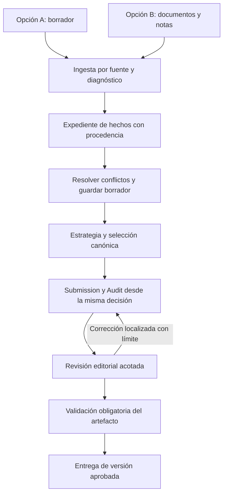

# RankPilot: validación ampliada, decisión arquitectónica y plan de ejecución

Fecha: 2 de octubre de 2026. Baseline Next.js local y producción Vercel: `af1368558ed38309e630b647e08dac9423848e02`.

> Estado histórico de la auditoría, previo a cambios funcionales. La implementación posterior y sus límites están en [el informe del 3 de octubre](IMPLEMENTACION_RANKPILOT_2026-10-03.md).

Este documento amplía el [dictamen inicial](DICTAMEN_ARQUITECTURA_RANKPILOT_2026-10-02.md). Su sección de limitaciones describe aquella primera revisión; la evidencia de producción y modelos nuevos que sigue la actualiza. No se modificó código funcional, no se desplegó y no se escribieron datos en las submissions de Ángela. Los replays de rutas Next usaron autenticación y base de datos simuladas; las consultas reales fueron de lectura. Las llamadas nuevas a modelos utilizaron contenido sintético.

## 1. Dictamen ejecutivo

**Conservar LangGraph y convertir el producto en un flujo con contratos verificables, estado duradero y una única autoridad de entrega. No adoptar literalmente cuatro agentes autónomos ni empezar eliminando nodos.**

La propuesta de Gemini acierta al separar registro de hechos, estrategia, redacción y revisión. No demuestra que cuatro llamadas basten, que el coste baje un porcentaje concreto ni que se alcance 98% de aceptación. La evidencia adicional confirma fallos anteriores al razonamiento editorial y posteriores a él: ingesta que declara éxito sin asuntos, pérdida de incertidumbre de confidencialidad, duplicación, criterios por nombres conocidos, certificaciones de plantilla y aprobación no vinculante.

Además, los logs de producción muestran el corredor Studio → optimizaciones por asunto → completion → exportación. Cambiar solamente `ai-engine/core/graph.py` dejaría activos los problemas de ese corredor. Ambos deben consumir el mismo expediente y decisión versionados.

La arquitectura debe generalizar **el proceso y sus garantías**, y parametrizar el criterio editorial por directorio, edición, jurisdicción y práctica. Una práctica sin criterios verificados puede admitir ingesta y borrador; no debe recibir una certificación estratégica inventada. Ningún sistema puede garantizar una banda otorgada por un tercero.

## 2. Evidencia adicional y alcance real

| Comprobación | Resultado observado | Límite de interpretación |
|---|---|---|
| Vercel | Deployment de producción READY con SHA `af13685`, igual al auditado | El SHA del backend Python no está expuesto por health |
| Datos actuales de Ángela | Dos submissions accesibles: DeForest y Ramos | No apareció Araquereyna en esta consulta; no significa que nunca existiera |
| DeForest | 32 filas Matter; 64 entradas en `chambersData.matters`, 32 IDs únicos repetidos dos veces | El momento y request que introdujeron la duplicación no están trazados |
| Ramos | 33 asuntos; selección canónica de 12; `release.passed=false` y `status=passed` | Inconsistencia de decisiones persistidas, no evaluación editorial independiente |
| Replay local de exportación con snapshots | Audit y Submission responden 200 para ambos; Audit de Ramos afirma exactamente 20 asuntos y certifica 91/100 | Rutas reales con DB/auth simuladas; no es captura del archivo descargado en producción |
| Logs Vercel generales | 50 IDs únicos en la muestra deduplicada; incluye 32 `/api/optimize/matter`, un B10, un completion y dos descargas | Las páginas repiten registros; no sumar 200 y 300 filas como ejecuciones distintas |
| Logs Vercel de extracción | 18 IDs únicos; extracción de 32 para DeForest y 33 para Ramos | No contienen todos los prompts, tokens ni decisiones internas |
| Telemetría AILog de Ángela | 37 registros; último 15 de septiembre; todos `durationMs=0`, `matterId=null`, respuesta de 5.000 caracteres | Inservible para reconstruir coste y duración de las corridas recientes |
| Render desplegado | `/health` online, versión 26.43; `/extract` con notas fiscales válidas retorna 200, `success:true`, cero asuntos | Una prueba sintética, no benchmark de todas las áreas |
| Render, entrada solo `sources` | 400 `Missing user_input` | Demuestra limitación del contrato HTTP, no fallo de todos los caminos de UI |

Los timestamps del snapshot contienen inconsistencias respecto de la hora de captura y algunos eventos. No se usaron para inferir duración ni orden causal exacto. Antes de construir métricas hay que comprobar UTC, reloj, origen del timestamp y correlación de requests.

Los snapshots completos y logs se conservaron fuera del repositorio, en `/private/tmp/rankpilot-private-review`, con acceso local restringido. Son evidencia temporal, no un sistema permanente de archivo. No se copiaron credenciales al informe ni al corpus de pruebas.

### Pruebas sintéticas ejecutadas

- [Contratos y renderers](reviews/stress-contracts-2026-10-02.json): 50 comprobaciones, 45 fallan. Incluyen 40 Audit DOCX —10 prácticas × 4 tamaños— que reproducen clases de defecto comunes. Cuatro de las cinco comprobaciones que pasan verifican solamente respuesta HTTP del replay, no aprobación editorial. **No es una tasa estadística de calidad.**
- [Ingesta sin modelos](reviews/stress-ingestion-2026-10-02-offline.json): 8 casos, 4 pasan y 4 fallan. Parseo numerado y DOCX básico funcionan; falla el contrato solo fuentes, la comunicación de fallo del extractor y la recuperación parcial de documentos. La receta en este conjunto prueba un error inyectado del extractor, no clasificación semántica.
- [Ingesta con modelo real](reviews/stress-ingestion-2026-10-02-live.json): 4 casos, ninguno cumple la expectativa. Receta aceptada como éxito con metadatos de firma inventados; notas M&A, dos asuntos IP y fuentes Energy contradictorias terminan sin asuntos. Endpoint Python real invocado localmente; timeout de QA 60 s y máximo 4.096 tokens, documentados en el resultado.
- [Contrafactual de manifiesto](reviews/manifest-counterfactual-2026-10-02.json): la misma materia fáctica M&A sí produce un asunto al indicar que el conteo es desconocido, usando directamente la cadena. Apoya el diagnóstico, pero cambian también el envoltorio y la vía de invocación: no es un experimento causal exhaustivo.
- [Backend desplegado](reviews/deployed-backend-probes-2026-10-02.json): health y dos solicitudes sintéticas confirman los comportamientos descritos arriba.
- [Duplicación en curador](reviews/curation-duplicate-probe-2026-10-02.json): un asunto excluido termina una vez entre oficiales y otra entre reserva. Reproducción local independiente; no prueba por sí sola que esa rama causara el estado histórico de DeForest.

### Diagnóstico de ingesta y persistencia

1. El fallback de ingesta convierte ausencia de numeración en `source_matters.total=0`. El prompt exige respetar ese universo exacto. **Desconocido se transforma en cero**, bloqueando la extracción narrativa. El diagnóstico combina código, llamadas locales, contrafactual y caso desplegado.
2. Excepciones del extractor pueden convertirse en lista vacía y finalmente en `success:true`. La UI no puede distinguir documento irrelevante, falta de evidencia y fallo técnico.
3. La recuperación por fuente llama a un `logger` no definido; un documento inaccesible produjo 500 por `NameError` en la prueba parcial.
4. La ruta Next elimina los asuntos previos antes de recrearlos, sin transacción que proteja el reemplazo completo. Un resultado vacío aparentemente exitoso puede sustituir el borrador. Esto es riesgo demostrado por lectura del código; no se provocó contra datos reales.
5. La misma ruta fija `confidentialityConfirmed:true` y deriva publicación desde un booleano, perdiendo `confirmation_required` de Python.
6. `updateSubmissionValidatedData` devuelve errores como resultado; el manejador de guardar no comprueba correctamente ese resultado. Guardar y salir navega en `finally`. Riesgo de confirmación falsa/pérdida de trabajo identificado en código; falta validación de navegador.
7. Actualizaciones concurrentes de asuntos escriben un JSON completo leído previamente. Hace falta control de revisión para impedir sobrescrituras entre trabajos. No se atribuye una pérdida histórica concreta sin traza.

## 3. Arquitectura objetivo y contratos

La orquestación reside en backend/worker con jobs duraderos; Next.js conserva experiencia, autorización y consulta de estado. El navegador no es responsable de completar el negocio. Reabrir sesión o recargar recupera el mismo job y borrador. LangGraph puede conservar checkpoints e interrupciones; PostgreSQL sigue siendo la fuente transaccional del producto. Se necesita coordinación explícita entre revisión del expediente, job y checkpoint, no dos estados independientes con autoridad contradictoria.

| Contrato | Responsabilidad y condición obligatoria |
|---|---|
| `SourceManifest` | ID/hash por archivo, tipo, estado de parseo, páginas/secciones; conteo `known/unknown`, nunca inferir cero por falta de etiquetas |
| `EvidenceLedger` | Hecho tipado, fuente y localizador, extracción o confirmación humana, conflictos, moneda/unidad, `unknown`; sin inferencias promocionadas a hechos |
| `MatterRegister` | IDs estables, vínculos entre documentos y asuntos; posibles duplicados como relaciones revisables; confidencialidad `public/confidential/unconfirmed` |
| `PracticePolicy` | Directorio, edición, jurisdicción, área, límites y requisitos con fuente/versionado; sin bandas o cuotas universales |
| `StrategyDecision` | Selección oficial/reserva/excluidos disjunta; motivos y referencias a evidencia; flagship único; banda actual verificada y objetivo separado de predicción |
| `EditorialPackage` | Secciones públicas y carta interna construidas desde la misma revisión; preguntas pendientes fuera de narrativa final; estilos y extensión configurables |
| `ReleaseVerdict` | Estado único, bloqueos y advertencias; IDs de revisión, política, prompts/modelo y hash del archivo exacto. Toda modificación invalida el veredicto anterior |

Esquemas compartidos/versionados entre Python y TypeScript mediante JSON Schema y generación o pruebas de compatibilidad Pydantic/Zod. Validar forma no basta: invariantes de negocio y procedencia se comprueban aparte. Instantáneas inmutables por revisión; actualizaciones transaccionales, idempotencia y control optimista de versión. El mapa de anonimización es inmutable **dentro de cada revisión**, no un diccionario global imposible de corregir.

### Responsabilidades de modelo y nodos

- **Registrar:** extrae candidatos y referencias después del parser determinista; reconcilia documentos sin certificar hechos ausentes. Puede necesitar varias llamadas por fuente/lote.
- **Estratega:** evalúa pertinencia y fuerza probatoria con la política aplicable; propone selección y cuestiones. La selección persistida se valida y gobierna las etapas siguientes.
- **Redactor:** produce Submission y Audit con públicos distintos. Pueden ser dos llamadas; no mezclar memoria técnica o dudas internas con prosa del despacho.
- **Editor:** señala defectos específicos contra reglas versionadas, no introduce nuevos hechos. Corrección dirigida con máximo inicial de dos intentos por paquete; agotarlo deja `needs_review`, nunca aprobación automática.

Conservar parser, contratos, renderers aprovechables, comprobaciones deterministas, checkpoints y observabilidad. Combinar pases de redacción redundantes solo cuando evals y trazas demuestren equivalencia o mejora. Retirar reglas por nombres de firmas/clientes, selecciones paralelas y fallbacks que certifican positivamente. El validador obligatorio tiene autoridad superior al juez probabilístico. Ningún camino de descarga debe saltárselo.

El número final de nodos se decide por responsabilidades, recuperación y medición; cuatro roles no equivalen a cuatro nodos ni a cuatro llamadas. No hace falta un framework de agentes nuevo para obtener estas propiedades. Referencia: [workflows y agents de LangGraph](https://docs.langchain.com/oss/python/langgraph/workflows-agents) y [persistencia](https://docs.langchain.com/oss/python/langgraph/persistence).

Caching: prefijos estables de instrucciones y política, datos específicos después; medir hits y coste real por modelo. No reutilizar respuestas basadas solo en texto parecido: el cache funcional debe incluir tenant, hashes de fuentes, revisiones y versiones. [Prompt caching](https://developers.openai.com/api/docs/guides/prompt-caching) no garantiza los porcentajes de Gemini. [Structured Outputs](https://developers.openai.com/api/docs/guides/structured-outputs) ayuda al contrato de forma, no acredita la verdad jurídica.

## 4. Comportamiento de producto requerido

| Situación | Respuesta y estado esperado |
|---|---|
| Receta/documento ajeno a la tarea | Mensaje claro de contenido no pertinente; conservar archivo/borrador para sustituirlo; no inventar firma/práctica |
| Documento jurídico de otra práctica | Advertir desajuste y ofrecer corregir área o conservarlo como fuente; no descartarlo silenciosamente |
| Un archivo falla entre varios | Resultado por fuente, extracción parcial identificada, reintento del archivo fallido sin duplicar lo procesado |
| Notas no numeradas | Conteo desconocido; detectar candidatos narrativos y mostrar procedencia para confirmación |
| Fuentes con cifras/monedas contradictorias | Mantener alternativas y preguntar; no sumar, convertir ni elegir arbitrariamente |
| Poca evidencia | Explicar qué falta por asunto; permitir borrador y preguntas; impedir certificación final si el bloqueo lo exige |
| Confidencialidad sin confirmar | No incluir identidad en salida pública; pedir confirmación sin declarar confidencialidad confirmada |
| Guardar, salir y volver | Confirmación solo después del commit; recuperar revisión exacta y uploads; errores visibles y reintentables |
| Doble clic, timeout o dos pestañas | Job idempotente, progreso recuperable, conflictos de versión detectados |
| Cambio después de aprobar | Nuevo borrador y validación; jamás servir un archivo nuevo con sello de otro |

La vista debe distinguir `saved`, `processing`, `needs_input`, `failed_retryable`, `ready_for_review`, `approved` y `released`. Un borrador descargable debe estar identificado como borrador y respetar confidencialidad; su existencia no equivale a certificación final.

## 5. Ángela como fuente de conocimiento reutilizable

Se inventariaron [116 archivos con hashes](reviews/angela-evidence-inventory-2026-10-02.json): 89 salidas, 10 capturas, 3 DOC heredados, 3 conversaciones de referencia y 11 fuentes/referencias. **Inventario no significa 116 documentos revisados ni aprobados por Ángela.** Las conversaciones pueden mezclar su voz con respuestas de modelos; atribuir una regla requiere distinguir ambas.

La revisión dirigida incluye Ramos, DeForest y pasajes de Compliance/González de Araujo. Estos últimos aportan reglas transferibles: describir la contribución jurídica concreta, no el negocio del cliente; no asumir que litigios federales son data protection; separar core, candidatos que necesitan evidencia, redundancias y problemas de encaje de práctica. La captura Tax `125208` acredita configuración Band 2 y objetivos de la sesión, no aceptación de un resultado ni instrucciones editoriales. Araquereyna sigue pendiente de replay de backend histórico.

| Regla candidata | Evidencia de origen | Conversión en criterio comprobable |
|---|---|---|
| Narrar contribución del despacho y resultado acreditado | Conversación Compliance, párrafo OOXML 5 | Rechazar párrafos centrados solo en actividad del cliente; cada logro conserva fuente |
| No inferir especialidad de una descripción genérica | Compliance, párrafo 70 | Litigio federal sin materia específica no se clasifica automáticamente como privacidad |
| Selección por fuerza y diversidad, no llenar veinte | Compliance, párrafos 383 y 869; revisión Ramos | Reservas/exclusiones justificadas; no promociones para alcanzar cuota |
| Distinguir evidencia disponible de petición pendiente | Conversaciones Ramos/DeForest y fallos comparados del dictamen | La pregunta no reaparece como hecho tras optimización |
| Coherencia entre Audit, Submission y selección | Contradicciones observadas en entregables históricos y replays | Mismos IDs, conteos, flagship y decisión en todos los documentos |
| Voz editorial limpia y carta interna separada | Propuesta Gemini y referencias locales; atribución individual pendiente | Sin logs, instrucciones al modelo o autoevaluación en secciones públicas |

Los números de párrafo corresponden al recorrido de elementos `w:p` desde cero; los hashes y rutas del inventario fijan la versión de fuente. Estas son reglas candidatas para formalizar, no todas citas ni mandatos ya aprobados por la dueña.

Implementar `FeedbackRecord` con archivo/hash, localizador, autor/atribución, comentario original, revisión de output, fallo, corrección esperada, alcance y severidad. Una corrección puede ser hecho de un cliente, preferencia de estilo o regla general: no mezclarlas. Flujo: observación → candidato → prueba positiva y contraejemplo → revisión experta cuando sea ambiguo/nuevo → regla activa versionada. Registrar conflictos y sustituciones. Mantener casos de evaluación reservados; no entrenar prompts con todos los ejemplos y luego medir sobre ellos.

La memoria automática puede sugerir candidatos; no aprobar reglas a partir de la propia salida del modelo. El conocimiento generalizable se separa de datos de cada firma y tenant. No insertar conversaciones enteras en cada generación.

## 6. Implementación por PR y condiciones de salida

Orden propuesto para ejecutar. Cada PR debe ser revisable y reversible; no se despliega una reescritura completa de una vez.

| PR | Trabajo concreto | Aceptación antes de avanzar |
|---|---|---|
| 1 — Integridad de entrega | Quitar hechos, bandas y score de plantilla; impedir bypass de release; unificar estados; distinguir borrador/final. Comprobar contenido final y ligar aprobación a hash/revisión | Cero nombres/cifras ajenos en matriz Audit; input bloqueado no obtiene archivo certificado; render final corresponde al aprobado |
| 2 — Ingesta A/B | Corregir unknown/zero, sources-only, errores del extractor y logger; diagnóstico por fuente; conservar incertidumbre y procedencia | Pasan los casos reproducidos de receta, M&A, IP, conflicto Energy y fuente parcial; fallo no reemplaza asuntos existentes |
| 3 — Borradores y modelo de datos | Reemplazo transaccional, revisión/idempotencia; triestado confidencialidad; arreglo de guardar/salir; deduplicación y particiones disjuntas | Fallos inyectados conservan borrador; recarga y reanudación verificadas en navegador; concurrencia sin perder ediciones; un ID no ocupa dos grupos |
| 4 — Decisión compartida | Un expediente/selección para Studio y Python; PracticePolicy; retirar reglas por nombres; suficiencia por evidencia, no solo conteo | Cambiar nombre de firma no cambia estrategia; diez registros vacíos no son suficientes; cambios de práctica no arrastran política previa |
| 5 — Orquestación duradera | Jobs backend, checkpoints, retry acotado, límites de coste, cancelación; migrar microacciones para consumir contratos comunes | Interrupción de navegador/worker recuperable; misma revisión produce decisiones compatibles por ambas rutas; trazas completas |
| 6 — Redacción y editor | Consolidar pases redundantes; separar públicos; juez con defectos localizados y máximo de reparación; validar OOXML final | Ninguna reparación agrega hechos; blockers no se convierten en warnings silenciosos; falla persistente termina needs_review |
| 7 — Feedback y evaluación | Registro versionado de Ángela, fixtures desidentificados, casos reservados, políticas por práctica y dashboard | Reglas con fuente y contraejemplo; informe por área/modalidad, sin aprobar una práctica por resultados de otra |
| 8 — Rollout | Shadow sobre corpus autorizado, comparación de outputs/coste/latencia; canary por cohortes y rollback por flag | Criterios editoriales e integridad cumplidos; rollback ensayado; sin fallback silencioso a entrega vieja insegura |

La instrumentación mínima de `run_id`, revisión, etapa, modelo/prompt, estado/error y duración empieza en PR 1; el sistema duradero completo llega en PR 5. La migración conserva snapshots originales, detecta duplicados y conflictos, y no corrige datos de Ángela destructivamente por heurística. La nueva ruta se habilita con feature flags. Nunca usar un fallo nuevo como razón para certificar automáticamente por el camino antiguo.

No se compromete plazo de nueve días ni ahorro porcentual sin medición. Después de PR 3 se puede estimar el resto con datos de complejidad, corpus y aceptación. La unidad de coste es submission aceptada, incluyendo reparaciones, extracción y reintentos; medir p50/p95, tokens entrada/salida/cache, errores y llamadas por fase.

## 7. Matriz de aceptación y pruebas siguientes

Objetivo inicial **planificado, aún no ejecutado**: 120 escenarios base = 10 prácticas × 2 modalidades × 6 condiciones (completo, insuficiente, ajeno/desajustado, duplicado, contradictorio y parcialmente ilegible/inaccesible). Añadir pruebas de confidencialidad, inyección de instrucciones en fuentes, concurrencia, interrupciones y persistencia. Variar idioma, extensión, estructura y calidad de OCR como estratos adicionales; no asumir cobertura por el producto cartesiano básico.

Prácticas iniciales: Real Estate, Labour, Tax, Corporate/M&A, Banking, Energy, Competition, IP, Data Protection y Disputes. Compliance amplía el corpus experto; no se considera validado por haber leído su conversación.

Tipos de comprobación:

1. Deterministas: ninguna identidad/cifra sin fuente; particiones sin duplicados; unknown preservado; cero identidades restringidas en superficie pública; release bloqueante y ligado al archivo.
2. Metamórficas: renombrar firma/personas, reordenar documentos y añadir copia no cambia hechos ni calidad; cambiar moneda sin equivalencia no produce conversión inventada; retirar evidencia reduce o mantiene soporte, nunca lo mejora por defecto.
3. Editoriales: criterio de experta con rúbrica versionada y evaluación ciega de pares; separar pertinencia, contribución jurídica, claridad, coherencia y utilidad de preguntas. El juez modelo es apoyo, no única verdad de aceptación.
4. End-to-end: carga real, feedback visible, guardar/salir, reabrir, resolver pendientes, optimizar, descargar y contrastar archivo con la revisión aprobada. Verificar paginación mediante render real, no estimación por palabras.
5. Holdout: firmas, nombres y formatos no presentes en prompts ni fixtures de desarrollo; varias ejecuciones para medir variación.

Exigir cero fallos críticos en el corpus antes del rollout; esto no demuestra probabilidad cero en producción. Establecer umbrales editoriales con la rúbrica y baselines medidos. Si una práctica no pasa, mantener explícitamente capacidades limitadas a borrador/revisión en esa práctica. No publicar 98% a partir de pruebas que solo comprueban HTTP 200.

## 8. Lo que todavía falta para certificar el flujo completo

- Logs internos de Render y SHA desplegado de Python, con run/request IDs correlacionados. Vercel da evidencia parcial; no sustituye esa traza. Se solicitó ubicación de acceso, sin pedir credenciales por chat.
- Recuperar la corrida histórica de Araquereyna y su relación exacta entre entrada, revisión humana y salida. El corpus local ayuda pero no reemplaza ese registro.
- Verificación real de navegador para guardado/reanudación y una corrida completa nueva de extracción → estrategia → edición → artefactos después de corregir los bloqueos. No se ha presentado un replay con stubs como esa prueba.
- Cerrar atribución/revisión de feedback restante; renderizar documentos para validar páginas y formato; medir costes/latencias completos con nueva telemetría.

Estos pendientes no impiden comenzar PR 1–3: sus defectos ya están reproducidos. Sí impiden declarar listo el sistema para cualquier caso o cerrar una certificación de producción. La decisión arquitectónica está suficientemente sustentada para iniciar la implementación incremental.
